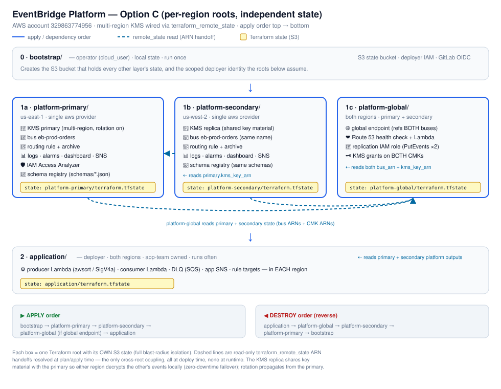

# Repository Structure — and WHY it is laid out this way

Read this first when taking over the repo. It explains not just *what* each
folder is, but the *reasoning* — so you can extend it without breaking the
design.

```
eventbridge-lab/
├── bootstrap/           Layer 0 — run ONCE by the operator (cloud_user)
├── platform-primary/    Layer 1a — primary-region platform + KMS primary key (deployer)
├── platform-secondary/  Layer 1b — secondary-region platform + KMS replica (deployer)
├── platform-global/     Layer 1c — global endpoint + health check + replication (deployer)
├── application/         Layer 2 — app objects: producers/consumers/targets (deployer)
├── app/                 LEGACY — original single-region demo (see app/README.md)
├── modules/
│   ├── eventbridge-platform/   reusable platform building block
│   └── event-application/      reusable application building block
├── src/lambda/       Lambda source: producer / consumer / health
├── schemas/          per-team event contracts (data-driven schema registry)
├── scripts/          lifecycle, verification, compliance, helpers
└── docs/             all documentation (indexed from README.md)
    └── legacy/platform/   ARCHIVED old single-root platform (retired; see its README)
```

> **Option C layout.** The platform used to be ONE root deploying both regions in
> a single state (`platform/`). It is now split into **three independent
> per-region roots**, each with its OWN state, for maximum blast-radius isolation
> (a region deploys/fails/rolls back on its own). The old single root was
> **retired** on 2026-10-28 and archived to `docs/legacy/platform/` (with its
> backend disabled) — the three roots below fully supersede it.

## Deployment architecture (cross-root)



The diagram shows every Terraform root as its own S3 state (yellow chips), the
AWS resources each root owns, and the read-only `terraform_remote_state` ARN
handoffs (dashed blue arrows) that wire the roots together. Apply order runs top
to bottom; destroy is the reverse. See the table below for the reasoning.

---

## The central idea: layers split by WHO runs them, HOW OFTEN, and WHICH REGION

The layering is not cosmetic. Each layer is a separate Terraform root with its
OWN state file, and the split maps to a **trust + lifecycle + blast-radius**
boundary. Under Option C the platform is further split **per region** so one
region can deploy, fail, or roll back without touching the other:

| Layer | Who runs it | How often | State | Why separate |
|---|---|---|---|---|
| `bootstrap/` | Operator (privileged, e.g. cloud_user) | Once | **local** | Creates the state bucket + deploy identities the other layers need. Chicken-and-egg: it can't use the remote bucket it is about to create, so its state is local. |
| `platform-primary/` | Deployer (scoped) | Rarely | remote (S3) | Primary-region bus/KMS-primary/rules/monitoring. Owns the multi-region KMS **primary** key. Nothing upstream; applied first. |
| `platform-secondary/` | Deployer (scoped) | Rarely | remote (S3) | Secondary-region bus/KMS-replica/rules/monitoring. Reads ONLY the primary CMK ARN from `platform-primary` state to create the KMS **replica** (shared key material → zero-downtime failover decrypts). |
| `platform-global/` | Deployer (scoped) | Rarely | remote (S3) | The cross-region glue that cannot live in either region: the global endpoint (references BOTH buses), Route 53 health check + health Lambda, the replication IAM role, and the KMS grants on both CMKs. Reads both regional states. Only applied when the global endpoint is enabled. |
| `application/` | Deployer (scoped) | Often | remote (S3) | Per-app Lambdas/DLQ/SNS/targets in both regions. App-team owned. Reads both regional platform states read-only. |

**Why split the platform per region (Option C)?** Maximum blast-radius isolation.
Each region has its own state, so a failed or rolled-back apply in one region
cannot corrupt or block the other, and the two regions can be versioned,
reviewed, and deployed on independent schedules. The cost is the cross-root
`terraform_remote_state` wiring below; the benefit is that "fail away from a
region" is true at the **deployment** layer, not just at runtime.

**Why the KMS key is multi-region (not two independent keys).** Failover and key
rotation both point the same way: the replica shares key material with the
primary, so an event encrypted in one region decrypts in the other with no
cross-region KMS call — exactly what zero-downtime failover needs — and rotation
happens once on the primary and propagates to the replica (one rotation, one
audit record, regions never drift). The only coupling is at DEPLOY time
(`platform-secondary` reads the primary key ARN); primary's runtime can be fully
down while secondary serves.

**Why not one big root?** Blast radius and ownership. An app team shipping their
consumer many times a day must never be able to accidentally destroy the shared
bus. Separate roots + separate state make the platform **immutable from the
application layer** — the app can *read* platform outputs but its `apply` cannot
touch platform resources.

**Apply order = dependency order:**
`bootstrap → platform-primary → platform-secondary → platform-global → application`.
Destroy is the reverse (`application → platform-global → platform-secondary →
platform-primary → bootstrap`). The `scripts/*-prod.sh` encode this so nobody has
to remember it (`platform-global` is skipped unless `ENABLE_GLOBAL_ENDPOINT=true`).

---

## Roots are THIN; modules hold the resources

The platform roots mostly wire a provider and pass variables — the real
resources live in `modules/eventbridge-platform` and `modules/event-application`,
which are **reusable and region-agnostic**.

Under Option C each regional root (`platform-primary`, `platform-secondary`)
uses a **single** default `aws` provider for its own region and calls the
platform module once. `platform-global` keeps BOTH `aws.primary` / `aws.secondary`
aliases because its resources genuinely span two regions (the KMS grant on the
secondary key is a secondary-region resource). A module still knows nothing about
"primary vs secondary"; the root injects the region through the provider.

**Cross-root wiring (the Option C cost).** Because the platform is split across
three states, the roots hand each other ARNs via `terraform_remote_state`:
- `platform-secondary` reads `platform-primary.kms_key_arn` (to create the replica).
- `platform-global` reads both regions' `bus_arn` + `kms_key_arn` (endpoint +
  replication role + KMS grants).
- `application` reads both regions' `platform` output object (bus/rule/kms/log/alerts).

These are **read-only** references resolved at plan/apply time against the S3
state bucket. To add a THIRD region you add a `platform-tertiary/` root (copy
the secondary root, point its replica at the primary key), extend
`platform-global` to reference the third bus, and add a module call in
`application`.

---

## `app/` vs `application/` — read this to avoid confusion

- **`app/`** = the ORIGINAL single-region lab. **Legacy.** Driven by the
  non-`-prod` scripts. Kept only as a simple demo. See `app/README.md`.
- **`application/`** = the production, multi-region app layer. Use this.

`app/` has none of the production capabilities (multi-region, global endpoint,
cross-account sharing, schema registry, Pipes, prod Scheduler, Access Analyzer).
Do not build new work in `app/`. It can be retired entirely; `application/`
supersedes it.

---

## Supporting directories

### `src/lambda/`
Lambda source, kept OUT of the Terraform dirs so the same code can be packaged by
whichever layer needs it:
- `producer/` — publishes `OrderPlaced` events (includes `requirements.txt` with
  `awscrt` for the global-endpoint SigV4a path).
- `consumer/` — processes routed events.
- `health/` — the HTTP 200/503 health probe behind the global endpoint's Route 53
  health check.

### `schemas/`
Per-team event contracts, one JSON file each. **Data-driven**: the platform
registers every `schemas/*.json`, so onboarding a team = drop a file (see
`docs/SCHEMA_ONBOARDING.md`). File name maps to the schema name
(`prod.orders__OrderPlaced.json` → `prod.orders@OrderPlaced`). `schemas/samples/`
holds contract-test fixtures (valid-* must pass, invalid-* must fail in CI).

### `scripts/`
Two tiers plus helpers:
- **Lifecycle:** `create-prod.sh` / `test-prod.sh` / `destroy-prod.sh` /
  `verify-prod.sh` (the layered build). The non-`-prod` ones drive the legacy
  `app/`.
- **`scripts/compliance/`:** an audit/evidence suite (static posture, functional,
  failure drills, multi-region, human checklist) — run to produce compliance
  evidence; see `scripts/compliance/README.md`.
- **Helpers:** `build-producer.sh` (vendors the manylinux `awscrt` wheel),
  `contract_test.py` (event contract validator), `who-can-assume.sh` (read-only
  trust-policy enumerator), `lib.sh` (shared bash helpers).

### `docs/`
All documentation, indexed from the top-level `README.md`. Start at
`PRODUCTION_ARCHITECTURE.md`.

---

## File conventions inside each Terraform dir

Every root/module follows the same split so the team always knows where to look:
- `main.tf` — resources + module calls
- `variables.tf` — inputs (every capability is a flag, default off)
- `outputs.tf` — what the layer exposes (the next layer consumes these)
- `versions.tf` — provider/version pins + the S3 backend block (roots only)

Capabilities are **opt-in flags** (`enable_*`, default `false`), so the proven
baseline is never changed by adding a feature — you turn one on deliberately.

---

## Mental model in one sentence

**Operator bootstraps identity + state once; the platform team owns the shared
bus as THREE per-region roots (primary key → replica → global glue), each with
its own state so a region fails on its own; app teams own their objects in a
separate state that can only read the platform — and every advanced capability
is a flag you turn on when you need it.**

> **Legacy note.** The old single-root `platform/` was **retired** and archived to
> `docs/legacy/platform/` (backend disabled). `app/` (the single-region demo) is
> also superseded, kept for reference. New work uses the three `platform-*` roots
> + `application/`.
