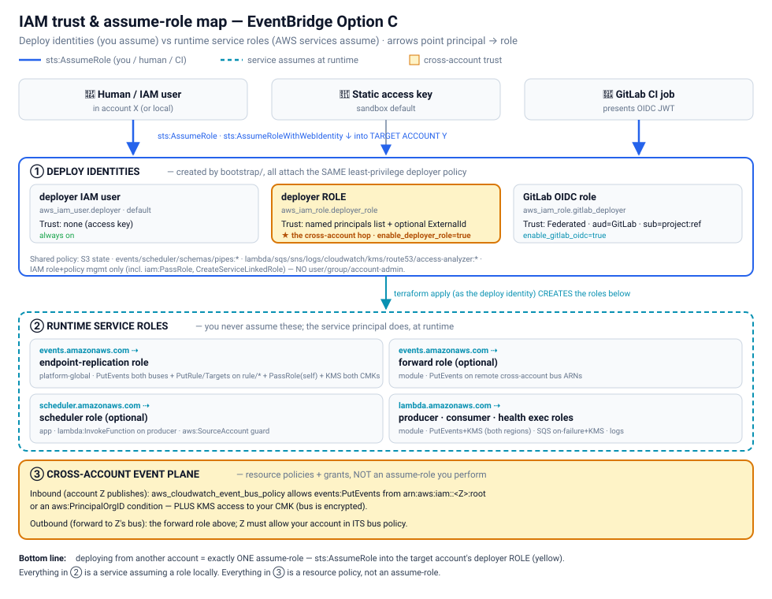

# Production Architecture — Multi-Region EventBridge Platform

Audience: system architects evaluating this for production. This document
describes the **AWS-recommended production architecture** the code implements,
the security/TLS posture, and the logging & monitoring design.

---

## 1. Regions

| Environment | Primary | Secondary (failover) | Notes |
| --- | --- | --- | --- |
| **Production** | `us-east-1` | `us-east-2` | Set `SECONDARY_REGION=us-east-2` + `ENABLE_GLOBAL_ENDPOINT=true` |
| **Sandbox test (this account)** | `us-east-1` | `us-west-2` | Pluralsight sandbox does **not** offer us-east-2; global endpoint left off (needs a public health domain) |

> The code is region-parameterized. The **only** change from sandbox-test to
> production is the two variables above — no code edits.

---

## 2. AWS-recommended architecture: Global Endpoints (active/standby)

The AWS-prescribed pattern for a **Regional-fault-tolerant** EventBridge
application is a **global endpoint** with event replication:

```
                                   ┌──────────────────────────────────────┐
   Producers  ──PutEvents(EndpointId)──▶  EventBridge Global Endpoint      │
                                   │   (Route 53 health check decides)     │
                                   └───────────────┬──────────┬───────────┘
                       healthy → PRIMARY           │          │  unhealthy → SECONDARY
                                                   ▼          ▼
        ┌──────────────── us-east-1 (PRIMARY) ─────┐  ┌──── us-east-2 (SECONDARY) ────┐
        │  Custom bus  eb-prod-orders  (KMS CMK)   │  │  Custom bus  eb-prod-orders    │
        │        │  rule: order_placed             │  │        │  (same name — required)│
        │        ▼                                  │  │        ▼                        │
        │  ┌───────────┐  ┌──────────┐  ┌────────┐ │  │  (identical target topology)   │
        │  │ Consumer  │  │  SNS     │  │ Audit  │ │  │                                 │
        │  │  Lambda   │  │  topic   │  │ CW Logs│ │  │                                 │
        │  └─────┬─────┘  └──────────┘  └────────┘ │  │                                 │
        │        │ retry+DLQ                        │  │                                 │
        │  ┌─────▼─────┐   ┌──────────┐             │  │                                 │
        │  │  SQS DLQ  │   │ Archive  │ (replay)    │  │                                 │
        │  └───────────┘   └──────────┘             │  │                                 │
        └───────────────────────────────────────────┘  └─────────────────────────────────┘
                   ▲                                              ▲
                   └──────── event replication (managed rules) ───┘
```

- **Route 53 health check** probes the primary region's `/health` endpoint. On
  failure it flips to "unhealthy"; within ~360s (AWS-published RTO/RPO) all
  custom events route to the secondary bus.
- **Event replication** (enabled) mirrors events to both regions so failover is
  automatic and the primary catches up on recovery.
- **Same bus name in both regions** is mandatory for global-endpoint failover —
  the code enforces this by using one `bus_name` variable for both.
- Producers must call `PutEvents` with `EndpointId` — the producer Lambda reads
  `ENDPOINT_ID` from its environment (wired from the `global_endpoint_id`
  output) and includes it automatically.

**Why active/standby (not active/active writes):** EventBridge global endpoints
are the native, no-extra-cost AWS mechanism for regional fault tolerance. Each
region independently processes what it receives, so consumers must be
**idempotent** (keyed on `orderId`) — the consumer in this lab is.

---

## 3. Layer separation (platform vs application)

Three independently-applied Terraform roots, each with its own state file in the
shared S3 backend:

| Root | Owner | Creates | State key |
| --- | --- | --- | --- |
| `bootstrap/` | operator (`cloud_user`) | S3 state bucket, deployer IAM user | `.../bootstrap/…` |
| `platform-primary/` | `eventbridge-lab-deployer` | KMS **primary** CMK, primary bus, rule, archive, logging, alarms, dashboard, Access Analyzer | `.../platform-primary/…` |
| `platform-secondary/` | `eventbridge-lab-deployer` | KMS **replica**, secondary bus, rule, archive, logging, alarms, dashboard (reads primary's key ARN) | `.../platform-secondary/…` |
| `platform-global/` | `eventbridge-lab-deployer` | Global endpoint, Route 53 health check + health Lambda, replication role, KMS grants (reads both regions) | `.../platform-global/…` |
| `application/` | `eventbridge-lab-deployer` | producer/consumer Lambdas, DLQ + consumer-failure queue, app SNS, rule **targets** — **both regions** | `.../application/…` |

The `application` root reads BOTH regional platform roots' outputs via
`terraform_remote_state`; `platform-secondary` reads `platform-primary` for the
KMS key; `platform-global` reads both. This gives you the separation you asked
for, now with **per-region blast-radius isolation** (each region is its own
state — see `docs/FOLDER_STRUCTURE.md`):

- **Platform team** owns the bus, encryption, routing rules, and observability
  and can evolve them without touching application code.
- **Application team** owns the producers/consumers and which targets attach to
  the rule, and deploys on its own cadence against a stable platform contract.

Reusable logic lives in `modules/eventbridge-platform/` and
`modules/event-application/`, so additional buses/apps are one module block each.

---

## 4. Security

### Deploy identity & IAM trust model

The stack has two distinct kinds of IAM: **deploy identities** (what runs
`terraform apply` — *you* assume these) and **runtime service roles** (what AWS
services assume at runtime — Terraform creates them, you never assume them).



- **① Deploy identities** (`bootstrap/`): a static deployer IAM user (sandbox
  default), an assumable **deployer role** (`sts:AssumeRole` by a named
  principals list + optional external id — the **cross-account hop**), and a
  **GitLab OIDC role** (`sts:AssumeRoleWithWebIdentity`, trust scoped to a
  project + ref). All three attach the **same** least-privilege policy.
- **② Runtime service roles**: the endpoint-replication role
  (`events.amazonaws.com`), the optional forward role (`events`), the optional
  scheduler role (`scheduler`), and the producer/consumer/health Lambda exec
  roles (`lambda`) — each assumed by its **service principal**, not you.
- **③ Cross-account event plane**: resource policies + KMS grants, **not** an
  assume-role you perform — a trusted account's bus policy + CMK access to
  publish inbound, or the forward role to send outbound.

> **Deploying from another account = exactly ONE assume-role**: `sts:AssumeRole`
> into the target account's **deployer role** (`enable_deployer_role=true`, name
> your principal, optionally an `sts:ExternalId`). See
> `docs/SECURITY_AND_ONBOARDING.md` for the full tables.

### Encryption at rest — customer-managed KMS (verified live)

A **multi-region KMS CMK** (`alias/eb-prod/eventbridge`, `mrk-…`) with **key
rotation enabled** encrypts every stateful surface:

| Resource | Encryption |
| --- | --- |
| EventBridge bus | `kms_key_identifier` = CMK |
| EventBridge archive | inherits the bus CMK |
| SQS DLQ | `kms_master_key_id` = CMK |
| SNS topics (app + alerts) | `kms_master_key_id` = CMK |
| CloudWatch Log groups | `kms_key_id` = CMK |
| Lambda log groups | `cloudwatch_logs_kms_key_id` = CMK |

The CMK key policy grants only the specific service principals
(`events`, `sns`, `sqs`, `lambda`, region-scoped `logs`) encrypt/decrypt, plus
the deployer as key administrator. The replica key in the secondary region is a
KMS multi-region **replica** of the primary, so both regions decrypt the same
logical key.

### Encryption in transit — TLS 1.2 and modern ciphers

Where TLS applies to *this* platform and how it is enforced:

- **AWS service APIs (EventBridge, SNS, SQS, Lambda, S3, KMS)** are HTTPS-only
  and AWS-managed at **TLS 1.2+ with modern cipher suites** — you cannot call
  them over cleartext. This lab additionally **denies non-TLS access** with
  resource policies (`aws:SecureTransport = false` → Deny) on the **SQS DLQ**,
  the **application SNS topic**, the **alerts SNS topic**, and the **S3 state
  bucket** (see below), so even a mis-signed SDK cannot fall back to HTTP.
- **Outbound HTTP targets (API destinations / connections)** are where a
  configurable TLS policy matters. When you add an API destination target,
  EventBridge connects over **TLS 1.2** to your HTTPS endpoint; terminate it on
  an **ALB or CloudFront with a TLS 1.2 security policy**
  (`ELBSecurityPolicy-TLS13-1-2-2021-06` on ALB, or
  `TLSv1.2_2021` on CloudFront) which restricts to modern ciphers. The lab
  documents this in `docs/TLS_POLICY.md`; no public HTTP endpoint is created in
  the sandbox test.
- **State bucket:** the bucket denies any request with
  `aws:SecureTransport = false` and (in production) can additionally require
  `s3:TlsVersion >= 1.2` via a bucket-policy condition.

### Identity & least privilege

- The app is **never** created/destroyed by `cloud_user`. A dedicated
  `eventbridge-lab-deployer` user (created once by the operator) runs all
  platform/application applies, scoped to the exact services in use.
- Lambda execution roles are generated per-function by the Lambda module with
  only the permissions each needs (producer: `events:PutEvents` on its bus +
  `kms` on the CMK; consumer: logging only).
- EventBridge invokes Lambda/SNS/SQS targets via **resource-based policies**
  scoped with `aws:SourceAccount`, not broad IAM roles.

---

## 5. Logging

| Signal | Destination | Retention |
| --- | --- | --- |
| Every matched event (audit trail) | CloudWatch Logs `/aws/events/<prefix>/audit` (a rule target) | 30 days (configurable) |
| Consumer processing / errors | CloudWatch Logs `/aws/lambda/<consumer>` | 30 days |
| Producer output | CloudWatch Logs `/aws/lambda/<producer>` | 30 days |
| Undeliverable events | SQS DLQ (14-day message retention) | 14 days |
| Full event history (replay) | EventBridge Archive | configurable |

All log groups are **KMS-encrypted**. The audit log group has a resource policy
allowing only `events.amazonaws.com` / `delivery.logs.amazonaws.com` from this
account to write.

For an org-wide audit trail, enable **CloudTrail** (management + EventBridge
data events) — out of scope for the sandbox but noted for production.

---

## 6. Monitoring & alerting

Per region, the platform creates:

- **CloudWatch alarms**
  - `rule-failed-invocations` — `AWS/Events FailedInvocations > 0`
  - `rule-throttled` — `AWS/Events ThrottledRules > 0`
  - `dlq-not-empty` — `AWS/SQS ApproximateNumberOfMessagesVisible > 0`
- **SNS alerting topic** (`<prefix>-platform-alerts`, KMS-encrypted, TLS-denied)
  that the alarms publish to. Subscribe PagerDuty/email/Slack in production.
- **CloudWatch dashboard** (`<prefix>-<region>-platform`) with a
  TriggeredRules/FailedInvocations/ThrottledRules time-series widget and a live
  audit-log query widget.

Recommended production additions: an alarm on the **global endpoint** health,
`AWS/Events IngestionToInvocationStartLatency`, and Lambda `Errors`/`Throttles`
alarms (the module can emit these).

---

## 7. Cost & DR posture

- **RTO/RPO ≈ 360s** (AWS-published) with the recommended alarm config.
- Event replication roughly doubles custom-event PutEvents cost; sized for
  resilience, not throughput.
- Everything else (Lambda, SQS, SNS, Logs) is per-region and scales to zero when
  idle — no always-on compute.

---

## 8. Verify in your account

```bash
# Sandbox test (us-east-1 + us-west-2, no global endpoint):
./scripts/create-prod.sh
./scripts/test-prod.sh      # proves producer→bus→rule→consumer + audit in BOTH regions
./scripts/destroy-prod.sh

# Production (us-east-1 + us-east-2, with global endpoint):
SECONDARY_REGION=us-east-2 ENABLE_GLOBAL_ENDPOINT=true \
  HEALTH_CHECK_DOMAIN=health.example.com ./scripts/create-prod.sh
```

---

## 9. Related docs

- **Cross-account / org-wide bus sharing** (publish-in + consume-out): `docs/CROSS_ACCOUNT_SHARING.md`
- **Pre-deploy account preflight prompt**: `docs/PREDEPLOY_PREFLIGHT_PROMPT.md`
- **TLS / cipher posture**: `docs/TLS_POLICY.md`
- **Free-tier / sandbox limits**: `docs/FREE_TIER.md`
