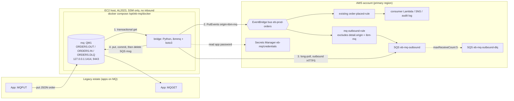

# IBM MQ <-> Amazon EventBridge integration (Docker on EC2)

> **Status: written from a design contract; not yet run on a live stack.**
> Terraform, Docker, bridge and scripts were produced in parallel and have not
> been exercised end to end. Anything below marked *unverified* needs a first
> live run (`scripts/test.sh`) before you rely on it.

## What this is and why

Many enterprises still run IBM MQ as the messaging backbone of a legacy estate.
This add-on lets such an estate join the shared EventBridge platform in this
repo without re-writing its applications: an application keeps doing
`MQPUT`/`MQGET` against queues it already understands, and a small **bridge**
service moves messages to and from the custom bus `eb-prod-orders`. Orders put
on `ORDERS.OUT` appear on the bus as `prod.orders` / `OrderPlaced` events (and
are routed by the existing rule to the existing consumer Lambda, SNS topic and
audit log). Orders published on the bus by anyone else are delivered back onto
`ORDERS.IN`.

For the lab, IBM MQ runs from IBM's developer container image under Docker
Compose on a single Amazon Linux 2023 EC2 instance. There is **no SSH and no
inbound port**: you reach the box with SSM Session Manager only, and
EventBridge-to-MQ traffic goes through an SQS queue that the bridge polls
outbound, so nothing on the internet needs to reach the instance. Delivery is
**at-least-once** in both directions, so consumers must be idempotent on
`orderId`. See [`docs/ARCHITECTURE.md`](docs/ARCHITECTURE.md).

## Architecture



Flow 1 (MQ to EventBridge): the bridge does a transactional get from
`ORDERS.OUT`, calls `PutEvents` (optionally through the global endpoint via
`EB_ENDPOINT_ID`) and commits the MQ unit of work only when
`FailedEntryCount` is 0. Flow 2 (EventBridge to MQ): `mq-outbound-rule` sends
matching events to SQS; the bridge long-polls, puts onto `ORDERS.IN`, commits,
and only then deletes the SQS message.

## Prerequisites

1. **The main lab is deployed** (`bootstrap` -> `platform-primary` -> ... ->
   `application`) so the bus `eb-prod-orders`, the existing rule and the
   consumer exist in the target region (default `us-east-1`). Use the root
   `scripts/create-prod.sh`; see [`../docs/GETTING_STARTED.md`](../docs/GETTING_STARTED.md).
2. **IBM MQ developer license.** The compose file sets `LICENSE=accept`. That
   is **your** acceptance of IBM's license for the IBM MQ Advanced for
   Developers container image. Read the license (link in the comment in
   `docker/docker-compose.yml`) before deploying. Do not deploy on behalf of
   someone who has not accepted it. The developer image is for development and
   test, not production.
3. Operator AWS profile (`OPERATOR_PROFILE`, default `default`), Terraform >= 1.10, AWS CLI v2, `jq`, and the Session
   Manager plugin (for `scripts/ssm-run.sh` / interactive sessions).
4. The instance needs outbound internet (image pull from `icr.io`, Docker
   Compose download from GitHub, Python packages). The default is a public IP in
   the default VPC; use `subnet_id` + NAT otherwise.
5. Repo rules from [`../CLAUDE.md`](../CLAUDE.md): deploy only on explicit
   approval, confirm the account ID, destroy must be proven clean.

### Account limits this stack enforces

| Limit | Value | Where it is enforced |
|---|---|---|
| Instance types | `t2`, `t3`, `t3a`, `t4g` in `micro`, `small`, `medium` only. Default `t3.medium`. `micro` (1 GiB) is too small for MQ + the bridge in practice. `t4g` is ARM: allowed by policy but **rejected by this stack** (x86_64 AMI, Compose binary and MQ client) | `terraform/variables.tf` validation |
| Root volume | 20 - 100 GiB (policy max 100 GB). Default 30 | `terraform/variables.tf` validation |
| Concurrent instances | at most **9** (stopped count, terminated do not). `deploy.sh` counts all enabled regions read-only and refuses if existing + 1 > 9; it fails closed in the deploy region | `scripts/deploy.sh` -> `mq_check_instance_quota` |
| MQ image | `icr.io/ibm-messaging/mq:10.0.0.5-r2` (IBM MQ Advanced for Developers), pinned. Tag confirmed to exist in icr.io (linux/amd64, s390x, ppc64le; **no arm64**); **not yet pulled or run** | `docker/docker-compose.yml`, `terraform/variables.tf` |
| Event contract | `schemas/prod.orders__OrderPlaced.json` v1.1.0 has optional `origin` and `correlationId`, so the bridge's full event detail validates | `schemas/`, `bridge/tests/test_contract.py` |

## Quick start

All commands run from the repo root. Safety classes follow the repo
convention: **READ-ONLY** (no AWS calls that change anything), **MUTATING**
(creates or changes real, billable resources).

| Step | Command | Safety class |
|---|---|---|
| 1. Verify | `bash mq-integration/scripts/verify.sh` | OFFLINE / READ-ONLY (fmt, validate, lint, static checks; no AWS) |
| 2. Deploy | `EXPECTED_AWS_ACCOUNT_ID=<12-digit id> bash mq-integration/scripts/deploy.sh --yes` | MUTATING, bills (EC2, EBS, SQS, S3, Secrets Manager). Needs explicit approval and the account ID confirmed from preflight |
| 3. Test | `bash mq-integration/scripts/test.sh` | LIVE: puts test messages and events; adds no infrastructure |
| 4. Destroy | `bash mq-integration/scripts/destroy.sh --yes` | MUTATING (deletes). Ends by running `leftover-check.sh` |
| Anytime | `bash mq-integration/scripts/leftover-check.sh` | READ-ONLY sweep |
| Anytime | `bash mq-integration/scripts/ssm-run.sh <instance-id> '<command>'` | Depends on the command you run on the host |

`test.sh` runs five end-to-end checks: health, MQ to EventBridge,
EventBridge to MQ, anti-loop, poison message to DLQ. What each proves and how
to debug each is in [`docs/RUNBOOK.md`](docs/RUNBOOK.md).

**Containers are ephemeral.** If you deploy from a Claude Code cloud session,
run `destroy.sh --yes` in the same session, or keep `STATE_BUCKET_NAME` so a
later session can run `scripts/cloud/restore-runtime.sh`. Never trust a
"destroyed" banner on its own: the proof is a clean `leftover-check.sh`.

## Cost

One `t3.medium` instance (about USD 0.04/hour on-demand in us-east-1, check
current pricing), a 30 GiB gp3 root volume, and pennies for SQS, S3 and
Secrets Manager (one secret). Roughly a dollar a day while it runs. The
instance is the only meaningful cost: **stop paying by destroying**
(`destroy.sh --yes`). Stopping the instance is not enough; EBS and the secret
keep billing. These figures are estimates, not measured.

## Everything that gets created

AWS (Terraform, `mq-integration/terraform`):

| Object | Name / detail |
|---|---|
| EC2 instance | AL2023, `t3.medium` default, IMDSv2 required, hop limit 2, encrypted gp3 root volume (30 GiB), tag `Name=eb-mq-mq-host` |
| Security group | `eb-mq-host-*`: all egress; **no ingress** unless `mq_client_cidrs` / `console_cidrs` are set |
| IAM role + instance profile | `eb-mq-host-*`: `AmazonSSMManagedInstanceCore` + inline policy `eb-mq-host` (PutEvents on the bus, optional bus-CMK use via EventBridge only, consume the outbound queue, one secret, read one S3 object) |
| EventBridge rule + target | `mq-outbound-rule` on `eb-prod-orders` -> SQS (target id `mq-outbound-sqs`, target DLQ configured) |
| SQS queues | `eb-mq-outbound` (visibility 60 s, long-poll 20 s, redrive after 5 receives), `eb-mq-outbound-dlq` (14 d retention); SQS-managed SSE; TLS-only policies |
| Secrets Manager secret | `eb-mq/credentials` (container only; values generated on the instance at first boot, never in Terraform state or user_data) |
| S3 bucket | `eb-mq-bundle-*`: private, SSE-S3, TLS-only, holds the zipped `docker/` + `bridge/` for the instance to fetch |

On the host (`/opt/eb-mq`, Docker Compose project `eb-mq`):

| Object | Name / detail |
|---|---|
| Containers | `eb-mq-mq-1` (IBM MQ), `eb-mq-bridge-1` (Python bridge) |
| Queue manager | `QM1`, listener 1414 and console 9443 bound to `127.0.0.1` |
| Queues | `ORDERS.OUT` (apps put, bridge gets; BOTHRESH 3, BOQNAME `ORDERS.DLQ`), `ORDERS.IN` (bridge puts, apps get), `ORDERS.DLQ` (backout target and QM dead-letter queue) |
| Channel | `APP.SVRCONN` (SVRCONN) |
| Auth objects | `EB.AUTHINFO` (IDPWOS, CHCKCLNT REQUIRED), CHLAUTH default-deny + `USERMAP` for `app` + `BLOCKUSER *MQADMIN`, AUTHREC for group `mqclient` on `ORDERS.**` |
| Users | `admin` (group `mqm`, console), `app` (group `mqclient`, client connections) |
| Volume | Docker volume `qm1data` (persistent messages) |
| Marker | `/opt/eb-mq/READY` written when MQ is healthy |

The IBM image also creates its own `DEV.*` objects (for example
`DEV.APP.SVRCONN`); they are not removed by this lab.

## Layout

```
mq-integration/
├── README.md                     # this file
├── terraform/                    # EC2, SG, IAM, SQS (+DLQ), rule, secret container, S3 bundle
│   └── templates/user-data.sh.tftpl   # first boot: install Docker, fetch bundle, generate secrets, compose up
├── docker/                       # docker-compose.yml, mqsc/20-eventbridge.mqsc, .env.example, test order
├── bridge/                       # Python bridge (ibmmq + boto3) and Dockerfile
├── scripts/                      # verify.sh deploy.sh test.sh destroy.sh leftover-check.sh ssm-run.sh
└── docs/
    ├── ARCHITECTURE.md          # flows, retry/backout, delivery semantics, shared-platform story
    ├── SECURITY.md              # threat model, TLS gap and how to close it
    ├── RUNBOOK.md               # day-2 operations, what each test proves
    ├── AWS_CLI_AND_MQ_COMMANDS.md   # hands-on cookbook
    └── TROUBLESHOOTING.md       # symptom -> cause -> check -> fix
```

## Known limits (honest)

- Single instance, single queue manager: no high availability. This is a lab,
  not a production MQ deployment.
- No TLS on the MQ channel (see [`docs/SECURITY.md`](docs/SECURITY.md)).
- `mq-outbound-rule` matches events whose `detail.origin` is absent OR not
  `ibm-mq` (anti-loop). The pattern follows the EventBridge docs but has not been
  exercised on a live bus yet.
- Not yet run on a live stack.
