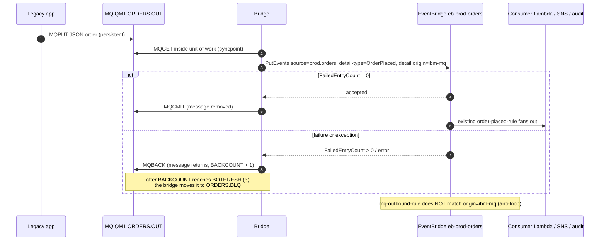

# Architecture — IBM MQ <-> EventBridge bridge

> **Not yet run on a live stack.** Behaviour below is the designed behaviour
> from the integration contract and the Terraform/MQSC written so far. Confirm
> with `scripts/test.sh` on a first deploy.

## 1. Components

| Component | Role |
|---|---|
| IBM MQ `QM1` (container `mq`) | Source and sink for legacy applications. Queues `ORDERS.OUT`, `ORDERS.IN`, `ORDERS.DLQ`; channel `APP.SVRCONN` |
| Bridge (container `bridge`) | Python, official `ibmmq` client + boto3. Two loops: MQ -> EventBridge and SQS -> MQ. Runs with the EC2 instance role |
| Bus `eb-prod-orders` | Existing platform bus (looked up by Terraform, never managed here) |
| `mq-outbound-rule` | Same source/detail-type as the lab rule, **excluding** `detail.origin = ibm-mq` |
| SQS `eb-mq-outbound` + `eb-mq-outbound-dlq` | Buffer between EventBridge and the bridge; the instance polls outbound |
| Secrets Manager `eb-mq/credentials` | `admin_password`, `app_password`, generated on first boot by the instance |

## 2. Flow 1 — MQ to EventBridge



Key points:

- The MQ message is removed **only after** EventBridge reports
  `FailedEntryCount` 0. A crash between `PutEvents` and `MQCMIT` re-delivers the
  message: the event is published twice (at-least-once).
- `detail.origin="ibm-mq"` is the loop guard. The rule excludes it, so an event
  that started in MQ never returns to MQ.
- Before publishing, the bridge validates the payload against the order
  contract (`schemas/prod.orders__OrderPlaced.json`: `orderId` UUID, `product`,
  `quantity` >= 1, `amount` >= 0, `placedAt`, no extra fields) and adds
  `detail.origin="ibm-mq"` and a `detail.correlationId` (MQ CorrelId if set,
  else MsgId). A message that fails validation cannot succeed on retry, so it
  is rolled back and follows the backout path (below).
- `PutEvents` is retried in-process (up to 5 attempts with backoff) before the
  MQ message is rolled back.

## 3. Flow 2 — EventBridge to MQ

```mermaid
sequenceDiagram
  autonumber
  participant P as Any producer (e.g. producer Lambda)
  participant EB as EventBridge eb-prod-orders
  participant Q as SQS eb-mq-outbound
  participant D as SQS eb-mq-outbound-dlq
  participant Br as Bridge (long-poll)
  participant MQ as MQ QM1 ORDERS.IN
  participant App as Legacy app

  P->>EB: PutEvents source=prod.orders, OrderPlaced (origin != ibm-mq)
  EB->>Q: mq-outbound-rule target (retries; target DLQ on delivery failure)
  Br->>Q: ReceiveMessage (wait up to 20 s, visibility 60 s)
  Br->>MQ: MQPUT inside unit of work
  alt put succeeds
    Br->>MQ: MQCMIT
    Br->>Q: DeleteMessage
    App->>MQ: MQGET from ORDERS.IN
  else put fails
    Br->>MQ: MQBACK
    Note over Br,Q: no delete; message reappears after visibility timeout
    Q->>D: after 5 receives (maxReceiveCount) moved to DLQ
  end
```

The text put on `ORDERS.IN` is the **full EventBridge event envelope**
(`detail-type`, `source`, `detail`, ...) as compact JSON. The bridge also drops
(deletes) any SQS event whose `detail.origin` is `ibm-mq` as a second loop
guard; a non-JSON SQS body is left alone so the redrive policy parks it in the
SQS DLQ.

The SQS message is deleted **only after the MQ commit**. If the bridge dies
after `MQCMIT` but before `DeleteMessage`, the message reappears and is put
again: a duplicate on `ORDERS.IN` (at-least-once).

## 4. Failure, retry and backout behaviour

| Situation | What happens | Where it ends up |
|---|---|---|
| EventBridge `PutEvents` rejects an entry (`FailedEntryCount` > 0) or throttles | MQ rollback; message retried on next get | Back on `ORDERS.OUT` |
| Bridge or host crash mid-flow 1 | Uncommitted unit of work is rolled back by MQ on disconnect | Back on `ORDERS.OUT`; possible duplicate event |
| Poison message (not JSON, missing `orderId`, repeatedly failing) | Each rollback increments `BACKCOUNT`. MQ does **not** move messages itself: the bridge checks `BACKCOUNT >= BOTHRESH` (3) and moves the message to `BOQNAME` (`ORDERS.DLQ`) in a committed unit of work | `ORDERS.DLQ` — inspect and replay manually (RUNBOOK §5) |
| MQ unavailable during flow 2 | Put fails, no SQS delete | SQS retries; after 5 receives the message moves to `eb-mq-outbound-dlq` |
| EventBridge cannot deliver to SQS (policy, KMS, deleted queue) | Rule target retry policy, then the target DLQ | `eb-mq-outbound-dlq` |
| Bridge cannot reach AWS (IMDS hop limit, IAM) | Both loops fail; MQ messages stay queued, SQS messages stay visible-after-timeout | Nothing lost; fix and restart |

SQS DLQ retention is 14 days; MQ DLQ messages are persistent and survive a
container restart (volume `qm1data`) but **not** a `destroy.sh`.

## 5. Delivery semantics

- **At-least-once both ways.** Exactly-once is not provided. Duplicates arise
  from crashes between the two commits (EventBridge/SQS and MQ) and from SQS
  redelivery after a visibility-timeout expiry.
- **Consumers must be idempotent on `orderId`.** The bridge keeps the `orderId`
  from the MQ payload in `detail`; the lab consumer logs it. Production
  consumers should dedupe on it (conditional write / unique key).
- **Ordering is not guaranteed.** The SQS queue is standard, EventBridge does
  not guarantee order, and a rolled-back MQ message can be re-read after later
  ones.
- **Size.** EventBridge entries max 256 KB; MQ messages larger than this fail
  and end up on the backout path.

## 6. Why SQS sits between EventBridge and the bridge

EventBridge cannot connect into an EC2 instance on a private TCP protocol, and
the lab's EC2 host has **no inbound rules**. An API destination or a Lambda
that pushed into MQ would need a reachable listener (or a VPC-attached
function and network path). With SQS the arrow reverses: the instance makes
outbound HTTPS calls to SQS, so:

- no inbound security group rule, no public listener, no SSH;
- the buffer absorbs downtime (retention 4 days by default, `sqs_retention_seconds`) and bursts;
- the DLQ gives a durable place for undeliverable events;
- the permission surface is two things: `sqs:SendMessage` for the rule only
  (`aws:SourceArn` condition) and a four-action consume policy for the instance.

The price is a polling latency of seconds (long-poll 20 s) and the duplicate
behaviour described above.

## 7. Shared-platform story

The base lab models a shared platform: one bus, platform-owned rules, and
app teams onboarding per [`../../docs/SECURITY_AND_ONBOARDING.md`](../../docs/SECURITY_AND_ONBOARDING.md).
A legacy MQ estate is the common real-world "team that cannot change its
code". This integration lets that estate:

- **publish onto the shared bus**: apps put an order, the bridge is the
  producer. Every existing subscriber (consumer Lambda, SNS fan-out, audit log,
  archive/replay) receives it with no change; the schema
  (`schemas/prod.orders__OrderPlaced.json`) is the contract, and the sample
  `docker/mq-test-order.json` conforms to it;
- **receive events back**: other teams' `OrderPlaced` events arrive on
  `ORDERS.IN`.

Treat the bridge as an application that onboards like any other: its IAM role
is least privilege (PutEvents on one bus), its events carry a recognisable
`origin`, and it has its own DLQs. For multi-account use see
[`../../docs/CROSS_ACCOUNT_SHARING.md`](../../docs/CROSS_ACCOUNT_SHARING.md): the bridge can live in a
spoke account and publish to a hub bus (not yet exercised; this integration
assumes the same account as the bus).

## 8. What changes with the global endpoint

Setting `eb_endpoint_id` (rendered into `bridge.env` as `EB_ENDPOINT_ID`) makes
the bridge call `PutEvents` with `EndpointId`.

- **Flow 1** then publishes through the global endpoint and survives a primary
  region impairment: events go to the secondary bus, where the secondary-region
  rules process them.
- **SigV4a is required**, which needs the `awscrt` package in the bridge
  image. Without it boto3 raises `MissingDependencyException`. Read §2 of
  [`../../docs/CICD_AND_OPERATIONS.md`](../../docs/CICD_AND_OPERATIONS.md) first.
- **Flow 2 is not made region-resilient.** `mq-outbound-rule` and
  `eb-mq-outbound` exist only in the one region this stack is deployed to. If
  that region fails over, the secondary bus has no rule feeding MQ. Closing the
  gap would need the same rule + queue in the second region and a bridge poll
  of both queues (not built).
- The instance policy allows `events:PutEvents` on the bus ARN; the
  global endpoint also needs the replication role and bus in both regions to
  exist (platform-global). Duplicates after failover/failback are possible;
  keep consumers idempotent.
