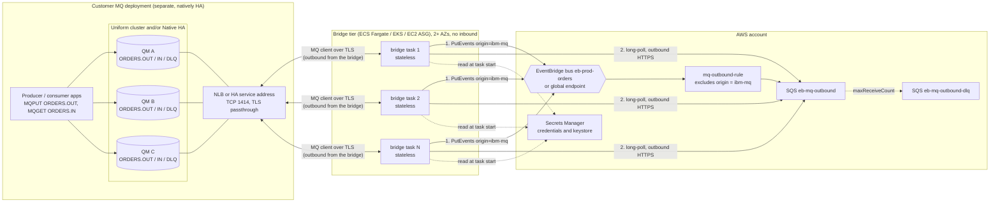

# Production guide — plugging the bridge into a separate, highly available IBM MQ

> **Nothing in this guide has been run against Native HA or a uniform cluster; the
> lab has one queue manager.** The lab runs a single `QM1` in IBM's developer
> container on one EC2 host. This guide describes how the *same* bridge and the
> *same* EventBridge integration would be plugged into a customer's separate MQ
> deployment later. Everything beyond the single-queue-manager behaviour is a
> design to be proven, not a result.

**Label legend.** Every non-trivial claim carries exactly one tag.

| Tag | Meaning | How far to trust it |
|---|---|---|
| **[TESTED]** | We ran it live in the lab (one queue manager, IBM MQ 10.0.0.5-r2 developer image, the bridge's `MQClient` and both loops) | Proven for the lab setup only |
| **[DESIGN]** | Reasoned from this repo's code, Terraform and MQSC; not run | Plausible; prove it with [`PRODUCTION_VERIFICATION_CHECKLIST.md`](PRODUCTION_VERIFICATION_CHECKLIST.md) |
| **[VERIFY]** | From general IBM MQ / AWS knowledge, not from this repo. Edition, version, platform support and exact syntax **must** be confirmed against your MQ version and licence in IBM's documentation | Treat as a pointer, not a fact |

Where an IBM detail is uncertain (edition requirements, CCDT JSON keys, Native HA
platform support) this guide says so and points to IBM's documentation instead of
guessing. Companion documents (owned separately, not duplicated here):

- [`BRIDGE_PRODUCTION_ROADMAP.md`](BRIDGE_PRODUCTION_ROADMAP.md): the exact bridge code changes.
- [`examples/20-eventbridge-cluster.mqsc.example`](examples/20-eventbridge-cluster.mqsc.example): the production MQSC.
- [`PRODUCTION_VERIFICATION_CHECKLIST.md`](PRODUCTION_VERIFICATION_CHECKLIST.md): how to prove each step.

---

## 1. Summary and target picture

In the lab MQ and the bridge share one EC2 host. In production the customer runs
MQ as its own, natively highly available deployment (Native HA queue manager
and/or a uniform cluster) owned by the MQ team. The bridge becomes a **stateless
MQ client** that runs elsewhere, in N copies across at least two availability
zones, and talks to MQ over the network. It is **never co-located with the queue
managers** and never joins the MQ cluster: it is an application like any other
(`MQCONNX` as a client, a SVRCONN channel). [DESIGN]

What changes is small and mostly on the connection edge; the event contract, the
loop guard and the delivery semantics stay as they are (section 2). What must be
built is listed in [`BRIDGE_PRODUCTION_ROADMAP.md`](BRIDGE_PRODUCTION_ROADMAP.md):
today's bridge connects to one `host(port)`, has no TLS, no connection list or
CCDT, no automatic client reconnect options and no APPLTAG. [TESTED] (read from
the code; the single-host path is what ran live)

Why the bridge stays outside the MQ cluster: it keeps its own scaling and release
cycle, it cannot destabilise queue-manager hosts, MQ patching and bridge
deployments stay independent, and the only coupling is a client channel and
three-to-five queue names. [DESIGN]

---

## 2. What stays the same

| Property | In the lab | In production |
|---|---|---|
| Event contract | `schemas/prod.orders__OrderPlaced.json` v1.1.0; the bridge validates before publishing and adds `detail.origin` and `detail.correlationId` [TESTED] | Unchanged. The MQ message body is still exactly the `OrderPlaced` contract, UTF-8 JSON. [DESIGN] |
| Loop guard | `detail.origin = "ibm-mq"` on every bridge event; `mq-outbound-rule` excludes it; the bridge also drops SQS events carrying it [TESTED] | Unchanged. Several bridge copies all stamp the same value. [DESIGN] |
| Delivery | At-least-once both ways. MQ get under syncpoint, commit only after `PutEvents` returned `FailedEntryCount` 0; MQ put, commit, then SQS delete [TESTED] | Unchanged, and it is what makes failover safe (section 7). [DESIGN] |
| Idempotency | Consumers dedupe on `orderId` [DESIGN: the lab consumer logs it, it does not dedupe] | Mandatory. Duplicates become more likely, not less, around failovers. [DESIGN] |
| SQS in front of the bridge | EventBridge cannot push into a private TCP listener, so the bridge pulls from SQS over outbound HTTPS [TESTED] | Unchanged: **the bridge needs no inbound port**, which matters even more when it runs in a shared container platform. [DESIGN] |
| Global endpoint | Optional `EB_ENDPOINT_ID`, SigV4a, needs `awscrt` [TESTED: `test-global-endpoint.sh`] | Unchanged. Read [`../../docs/CICD_AND_OPERATIONS.md`](../../docs/CICD_AND_OPERATIONS.md) section 2 before enabling. |
| Ordering | Not guaranteed [TESTED] | Still not guaranteed, and weaker (section 3). |

---

## 3. Topologies

Pick the topology with the MQ team; the bridge supports all three with the
roadmap items, but they differ in what the bridge must do. IBM specifics change
between versions and editions: confirm each against IBM's documentation for the
MQ version you run (start at the "High availability" and "Uniform clusters"
chapters of the IBM MQ docs). [VERIFY]

### A. Single Native HA queue manager

One logical queue manager, three instances (one active, two replicas) that
replicate the queue-manager data between them; if the active instance fails, a
replica takes over. [VERIFY]

- **Bridge connection.** Clients connect to the *active* instance, either through
  a stable service address (a Kubernetes Service / NLB in front of the instances
  when MQ runs in containers) or through a **connection-name list** naming all
  three instances. [VERIFY: how clients find the active instance differs by
  platform and version; check IBM's Native HA client-connectivity topic]
- **What the bridge needs.** After a failover the existing TCP connection is
  dead. Today's bridge already closes and reconnects with backoff 1 s to 30 s and
  MQ backs out the uncommitted unit of work, so a failover costs seconds of
  throughput and possibly one duplicate. [DESIGN: reasoned from
  `to_eventbridge.py`/`from_eventbridge.py`; no failover has been run] To get fast, transparent
  reconnect the bridge should set the MQ client's automatic-reconnect option and
  accept a connection list (roadmap). [VERIFY]
- **Platform and edition.** Which platforms support Native HA (container
  operator on Kubernetes/OpenShift; Linux packages in newer versions), the
  minimum MQ version, and whether it needs the Advanced entitlement are **not
  confirmed here**. [VERIFY: IBM MQ licensing and "Native HA" platform support
  pages]
- **Ordering.** Single queue, so the *queue manager* keeps FIFO within priority;
  the bridge itself does not preserve it (see "Ordering" below). [DESIGN]

### B. Uniform cluster of N queue managers

N queue managers with the same configuration in one MQ cluster, with applications
connecting through a **CCDT** so they can be spread across, and moved between,
queue managers. [VERIFY]

- **Connection.** The bridge points at a CCDT (or a queue-manager group name)
  rather than a host. For rebalancing, every bridge connection carries the same
  **APPLTAG** and uses the automatic-reconnect option, so the cluster can move
  connections until each queue manager holds an even share of the `N` bridge
  instances. [VERIFY: rebalancing rules, the minimum MQ version and the exact way
  to set APPLTAG from the `ibmmq` Python client]
- **CCDT.** MQ supports a JSON-format CCDT in newer versions. The exact key names
  (connection list, queue-manager group, weights, affinity, reconnect settings)
  are **not reproduced here**: copy them from IBM's CCDT reference for your
  version. [VERIFY]
- **A clustered `ORDERS.OUT` has an instance on every queue manager.** An `MQGET`
  only reads the *local* instance, so a bridge connected to QM B never sees
  messages that cluster workload balancing put on QM A. **There must be at least
  one consuming bridge connection on every queue manager that hosts an
  `ORDERS.OUT` instance**, or messages sit there until a consumer arrives. This
  is why the bridge count `N` must be at least the queue-manager count, ideally a
  multiple of it, and why the per-queue-manager queue depth needs an alarm
  (section 7). [DESIGN]
- **A clustered `ORDERS.IN` is workload-balanced on put.** The bridge's put goes
  to one of the instances. Two traps: (1) the default queue binding fixes an
  open handle to one instance, and the bridge keeps its `ORDERS.IN` handle open
  for hours, so everything would go to one queue manager unless the queue (or the
  open) is **not-fixed**; (2) when a local instance exists, MQ prefers it unless
  the queue's `CLWLUSEQ` allows any instance. [VERIFY: `DEFBIND(NOTFIXED)` and
  `CLWLUSEQ(ANY)`, or define `ORDERS.IN` on a subset of queue managers, and see
  the example MQSC in
  [`examples/20-eventbridge-cluster.mqsc.example`](examples/20-eventbridge-cluster.mqsc.example)]
  The consuming applications then also need to `MQGET` `ORDERS.IN` on every
  queue manager that hosts an instance (the same "consumer on every QM" rule as
  `ORDERS.OUT`). [DESIGN]
- **Availability limit.** A uniform cluster of single-instance queue managers
  gives *service* availability (apps and bridges keep working on the survivors)
  but **not message availability**: persistent messages already on a failed queue
  manager are stuck until it comes back. [VERIFY: confirm for your configuration;
  this is the reason for topology C]

### C. Both: a uniform cluster whose members are each Native HA

Each cluster member is a Native HA queue manager (three instances). This combines
A's message availability with B's scale-out and rebalancing, at the highest
operational cost: the bridge needs everything from A and B (CCDT or connection
list per member, APPLTAG, reconnect, a consumer on every member). [DESIGN]

### Alternatives (one line each)

- **Multi-instance queue manager** (active plus standby on shared storage): proven
  and simple, but needs a shared file system with correct locking semantics;
  confirm which AWS storage IBM supports for it. [VERIFY]
- **RDQM** (replicated data queue manager): Linux-only, with its own Pacemaker
  cluster and network requirements; confirm support on your instance type and
  AWS networking before choosing it. [VERIFY]

### Decision table

| | A. Single Native HA QM | B. Uniform cluster (N plain QMs) | C. Uniform cluster of Native HA QMs |
|---|---|---|---|
| Message availability on a node loss | Yes (replicas hold the data) [VERIFY] | **No**: messages on the failed QM wait for it [VERIFY] | Yes [VERIFY] |
| Throughput scaling | Vertical only (one active instance) [VERIFY] | Horizontal across N QMs [VERIFY] | Horizontal across N QMs [VERIFY] |
| Ordering | FIFO per queue at the QM; bridge copies reorder (below) [DESIGN] | No global ordering; workload balancing spreads messages [DESIGN] | Same as B [DESIGN] |
| Failover behaviour seen by the bridge | Connection drops, reconnect to the new active; seconds [VERIFY] | A QM drops: its connections move to survivors; its messages wait [VERIFY] | Both effects, per member [VERIFY] |
| Bridge connection | One address or a 3-entry list [VERIFY] | CCDT, same APPLTAG, reconnect [VERIFY] | CCDT with a connection list per member, APPLTAG, reconnect [VERIFY] |
| Consumer needed on every QM | n/a | **Yes** [DESIGN] | **Yes** [DESIGN] |
| Bridge code beyond today's | Connection list or HA address; reconnect option; TLS [DESIGN] | A + CCDT, APPLTAG, per-QM visibility [DESIGN] | B [DESIGN] |
| Operational weight | Lowest | Medium | Highest |

### Ordering

**Global message ordering is NOT preserved** once there is more than one bridge
instance or more than one queue manager: instances race, a rolled-back message is
re-read after later ones (already true in the lab), clustered queues spread
messages, and SQS is a standard queue. [TESTED for the single-instance rollback
reordering; DESIGN for the rest] If a business flow needs ordering per key
(for example per customer), the consumers must order or tolerate it using fields
in the payload; do not rely on arrival order. [DESIGN]

---

## 4. Network and connectivity

| Concern | Recommendation |
|---|---|
| Where the bridge runs | ECS on Fargate, EKS, or an EC2 Auto Scaling group, in at least two AZs, private subnets, no public IPs. Same VPC as MQ, or reachable through Transit Gateway or Direct Connect when MQ is on premises or in another account. [DESIGN] |
| Inbound to the bridge | **None.** The security group has no ingress rules; only egress to MQ (TCP 1414 or the chosen listener port), HTTPS to the AWS endpoints, and DNS. [DESIGN] |
| MQ listener when MQ runs in containers | An internal **Network Load Balancer**, TCP listener (TLS passthrough, not a TLS-terminating listener, because MQ negotiates TLS and mutual authentication itself), one target group per queue manager or per HA service. [VERIFY: preserved client IP and idle timeout behaviour, see below] |
| NLB idle timeout vs MQ heartbeat | The lab sets `HBINT(300)`. An NLB drops idle TCP flows after a timeout (350 s by default for TCP, to be confirmed) and the bridge's `ORDERS.IN` connection can sit idle between SQS messages. Use a shorter `HBINT` and TCP keepalive (`KAINT` / OS keepalive) well below the NLB timeout. [VERIFY] |
| Client IP in CHLAUTH | Behind an NLB the queue manager may see the NLB address rather than the task IP, so `ADDRESSMAP` rules by client IP are weak. Authenticate by certificate (`SSLPEERMAP`) and treat the address rule as a coarse filter. [VERIFY] |
| VPC endpoints | Interface endpoints for `events`, `sqs` and `secretsmanager` (and `logs`, `ecr.api`, `ecr.dkr` plus the S3 gateway endpoint for image pulls) so the bridge subnets need no NAT. Add `kms` if the bus or queues use a CMK. Endpoint policies restrict to the bus, queue and secret ARNs. [DESIGN] |
| DNS | Give the MQ service a private DNS name (Route 53 private zone) and use that in the CCDT or connection list, never an instance IP. Keep TTLs short enough that a replaced NLB or pod is found; long-lived MQ connections do not re-resolve until they reconnect. [DESIGN] |
| Cross-account | If the bridge runs in a spoke account, set `EVENT_BUS_NAME` to the hub bus **ARN** and follow [`../../docs/CROSS_ACCOUNT_SHARING.md`](../../docs/CROSS_ACCOUNT_SHARING.md). Flow 2 then needs the hub rule to forward to a bus in the bridge's account, whose own rule feeds the SQS queue, because an SQS target must be in the rule's account. [DESIGN: not exercised; the repo's integration assumes the same account as the bus] |

---

## 5. Identity and security for production

The lab authenticates with one shared password in an environment variable over
an unencrypted channel. [TESTED] None of that is acceptable in production.

### 5.1 TLS on the channel

1. Give the channel a cipher spec: `SSLCIPH('ANY_TLS12_OR_HIGHER')` or a specific
   spec chosen with [`../../docs/TLS_POLICY.md`](../../docs/TLS_POLICY.md) and
   the customer's policy; add `SSLCAUTH(REQUIRED)` for mutual TLS. [VERIFY:
   cipher spec names depend on version and FIPS mode]
2. The queue manager needs a key repository (`SSLKEYR`) holding its certificate;
   the bridge needs a client key repository with the CA chain (and its own
   certificate for mutual TLS). [VERIFY]
3. The `ibmmq` client takes the key repository location and the cipher spec on
   the connection; the exact `SCO` / `CD` field names for the Python binding are
   a roadmap item. [VERIFY]
4. Certificate rotation: issue the new certificate before the old one expires;
   on the queue manager refresh the SSL configuration (`REFRESH SECURITY
   TYPE(SSL)`); the bridge picks the new key repository up on its *next*
   connection, so a rolling restart of the tasks finishes the rotation. Alarm on
   certificate expiry at 30 and 7 days. [VERIFY: refresh behaviour and whether
   existing channels restart]

### 5.2 Authentication

| Option | What it is | Bridge impact |
|---|---|---|
| Password via LDAP | `AUTHINFO ... AUTHTYPE(IDPWLDAP)` with `CHCKCLNT(REQUIRED)`; the bridge keeps sending user + password in the MQCSP | **No code change** beyond TLS. The simplest first production step. [VERIFY: LDAP connection and group attributes are customer-specific] |
| Mutual TLS identity | The client certificate maps to an MQ identity with a `CHLAUTH TYPE(SSLPEERMAP)` rule (`SSLPEER` DN filter, `USERSRC(MAP)`, `MCAUSER`) | The bridge must be able to connect **without** user/password: `config.py` currently requires `MQ_USER` and `MQ_PASSWORD`, so this is a code change (roadmap). Whether the queue manager's `CHCKCLNT` setting still demands a password for such connections must be checked. [VERIFY] |
| Customer identity provider | Whatever the MQ platform team standardises on (OS users, LDAP, or a token-based option in newer versions) | Needs a conversation, not a guess. [VERIFY] |

Do **not** carry over the lab's identity model. The lab's MQSC grants rights to
`PRINCIPAL('app')` because the 10.0.x developer image has no OS users or groups
(an earlier `GROUP('mqclient')` draft was rejected by MQ with AMQ8871E), and its
single `USERMAP` plus `USERSRC(CHANNEL)` relies on that. [TESTED] Production MQ
normally authorises **groups** from the OS or LDAP, so `AUTHREC` should be on a
`GROUP(...)` and the bridge identity should be a member of a dedicated group.
Copying `20-eventbridge.mqsc` as-is would either fail or grant the wrong things.
[VERIFY]

### 5.3 Least-privilege AUTHREC for the bridge

Derived from what `mq_client.py` opens (`MQOO_INPUT_SHARED | MQOO_INQUIRE`,
`MQOO_OUTPUT`) — not run with this reduced set; the lab granted a superset
(`CONNECT,INQ` on the queue manager; `PUT,GET,INQ,BROWSE` on `ORDERS.**`) and
that superset worked. [TESTED for the superset; DESIGN for the minimum]

| Object | Authorities the bridge needs | Why |
|---|---|---|
| Queue manager | `CONNECT`, `INQ` | connect; the code inquires on queues, not the queue manager, but the lab granted `INQ` and the standard client handshake is safest with it [DESIGN] |
| `ORDERS.OUT` | `GET`, `INQ` | open for shared input and inquire `BOTHRESH` and `BOQNAME` [DESIGN] |
| `ORDERS.IN` | `PUT` | open for output [DESIGN] |
| Backout queue (`BOQNAME`; `ORDERS.DLQ` in the lab) | `PUT` | the bridge re-puts poison messages itself [DESIGN] |
| `BROWSE` | Not used by the code. Grant it only to the operators' group that inspects the DLQ, not to the bridge. [DESIGN] | |
| Not granted | `ALT`, `SETID`, `SETALL`, `PASSALL`, any `+dsp`/`+chg`/`+crt`/`+dlt`, `*MQADMIN`, `CLEAR` | the bridge never needs them [DESIGN] |

Also keep the lab's other two controls, expressed for production: a default-deny
`CHLAUTH` rule plus a specific allow rule on the bridge's channel, and
`BLOCKUSER('*MQADMIN')` on it. In a cluster, the cluster channels have their own
`CHLAUTH`/`MCAUSER` handled by the MQ team. [VERIFY]

Use a **dedicated backout queue** (for example `ORDERS.BACKOUT`) rather than the
lab's choice of one `ORDERS.DLQ` serving both as the queue-manager dead-letter
queue and as the backout target: it keeps bridge-detected poison messages apart
from messages MQ itself could not deliver. [DESIGN] See the example MQSC.

### 5.4 Credentials and keystores from Secrets Manager

The lab host generates its passwords at first boot and writes them to a root-only
`.env`; the bridge reads `MQ_PASSWORD` from the environment and `SECRET_ID` is
informational only, **the code does not read Secrets Manager**. [TESTED, from
the code] In production:

- Store the bridge identity (password, or the client certificate and its key
  repository passphrase) in Secrets Manager under a name owned by the MQ platform
  team, with a resource policy and IAM permission limited to the bridge task
  role (`secretsmanager:GetSecretValue` on that one ARN; drop the lab's
  `PutSecretValue`). [DESIGN]
- Inject at task start through the platform's native mechanism (ECS task
  definition `secrets` for environment variables; External Secrets or the Secrets
  Store CSI driver on EKS). That needs **no code change** for the password, but a
  key repository is a file, so it needs an entrypoint step that writes it to a
  tmpfs path, or a mounted volume (roadmap decides which). [DESIGN]
- Rotation: rotate in Secrets Manager (a rotation Lambda or a managed rotation
  against the directory), then roll the bridge tasks. Because injection happens
  at start, **rotation is not picked up by running tasks**. Overlap the old and
  new credentials for one rolling restart; the lab's own rotation procedure has
  not been exercised ([`RUNBOOK.md`](RUNBOOK.md) status note). [DESIGN]
- Never log or echo credentials; the bridge already redacts the password in the
  config `repr`. [TESTED]

---

## 6. How to plug in: step-by-step checklist

Each step has an owner, the action, and a pointer to the matching proof in
[`PRODUCTION_VERIFICATION_CHECKLIST.md`](PRODUCTION_VERIFICATION_CHECKLIST.md).
Do not move on until the step's checks pass. None of these steps has been run
against a clustered or HA queue manager.

| # | Who | Where | What | Verify |
|---|---|---|---|---|
| 1 | Architects + MQ team + EventBridge platform team | Design review | **Agree names and contract.** Queue names (`ORDERS.OUT`, `ORDERS.IN`, backout queue), queue-manager or CCDT names, channel name, bus and source, `OrderPlaced` schema version, `origin` value, who owns each object. Choose topology A, B or C (section 3) and the licence/edition. | Checklist: contract and naming section. The contract itself: `bridge/tests/test_contract.py` [TESTED] |
| 2 | MQ team | The customer's queue managers | **Create the MQ objects** from [`examples/20-eventbridge-cluster.mqsc.example`](examples/20-eventbridge-cluster.mqsc.example): queues with `BOTHRESH`/`BOQNAME`, persistence, cluster attributes (`CLUSTER`, `DEFBIND`, `CLWLUSEQ`), the SVRCONN channel with TLS, dead-letter queue. Apply to every queue manager in B/C. | Checklist: MQ object section (adapt `scripts/verify-mq-objects.sh` to the production names) |
| 3 | MQ security team | MQ + directory | **Create the bridge identity** and its group; `AUTHREC` per 5.3; `CHLAUTH` allow rule for the channel; certificate issued if using mutual TLS. | Checklist: identity and authorisation section |
| 4 | MQ + network teams | NLB / Service, DNS, security groups | **Expose the listener** on a stable private name; open only the bridge subnets to 1414 (or the chosen port); set `HBINT`/keepalive below the NLB idle timeout. | Checklist: network and connectivity section |
| 5 | Platform team | AWS (Terraform) | **Provision the AWS side** without the EC2 host (below): rule, SQS and its DLQ, queue policies, a task IAM role, the secret. | Checklist: AWS side section (`describe-rule`, queue attributes) |
| 6 | Bridge developers | `bridge/` | **Implement the roadmap items** in [`BRIDGE_PRODUCTION_ROADMAP.md`](BRIDGE_PRODUCTION_ROADMAP.md): TLS, connection list or CCDT, reconnect, APPLTAG, configuration for secrets. Keep `pytest` green. | `scripts/verify.sh` offline; checklist: bridge build section |
| 7 | Platform team | ECR + ECS/EKS/ASG | **Deploy bridge tasks**: N copies across 2+ AZs, task role, secrets injection, `stopTimeout`/grace period above 45 s, health check tuned (section 7), no inbound. Start with `N = 2` (A) or `N = 2 x QMs` (B/C). | Checklist: deployment section |
| 8 | QA + MQ team | Pre-production | **Run the live checks** against the real MQ: MQ to EventBridge, EventBridge to MQ, anti-loop, poison to backout queue (the four lab scenarios of `scripts/test.sh`, adapted), plus failure drills: kill the active instance, kill a bridge task, restart a queue manager. | Checklist: live checks and failure drills |
| 9 | QA + operations | Pre-production | **Soak test**: sustained load with random failovers and rolling restarts for an agreed period; count duplicates, losses (must be zero), DLQ entries, queue ages. | Checklist: soak section |
| 10 | Platform team | Terraform + bridge config | **Enable the global endpoint** (if wanted): `awscrt` in the image, `EB_ENDPOINT_ID`, `events:PutEvents` on both buses, SigV4a. | Checklist: global endpoint section; [`../../docs/CICD_AND_OPERATIONS.md`](../../docs/CICD_AND_OPERATIONS.md) section 2 |
| 11 | Operations | CloudWatch / MQ monitoring | **Alarms and runbooks** (section 7): queue depth and age per QM, backout queue depth, SQS DLQ, bridge health, certificate expiry. | Checklist: observability section |
| 12 | Business + operations | Cutover plan | **Cut over**: run in shadow (bridge consuming a copy or a test queue), switch producers/consumers to the new queue names or the production queue manager, keep the old path for rollback, watch for duplicates, then retire the lab. | Checklist: cutover and rollback section |

### Which Terraform parts to reuse (step 5)

`mq-integration/terraform/` mixes the lab host with the integration. A
production stack should keep the integration pieces and drop the host. [DESIGN]

| Reuse (adapt) | Drop |
|---|---|
| `aws_sqs_queue` `outbound` and `dlq`, the two queue policies (rule may send, TLS only) | `aws_instance.mq`, the AMI lookup, `user_data` and the template `user-data.sh.tftpl` (Docker/Compose install, bundle fetch, password generation) |
| `aws_cloudwatch_event_rule.outbound` with its anti-loop pattern, and `aws_cloudwatch_event_target.outbound` with the target DLQ | The S3 bundle bucket, `archive_file`, the bundle object (images come from ECR instead) |
| IAM *statements*: `PutEventsOnBus` (including `failover_bus_arns`), `BusCmkUse`, `ConsumeOutboundQueue` | `aws_iam_role.host` trusting `ec2.amazonaws.com`, the instance profile, the SSM managed-instance attachment, `ReadBundle`; **replace** with a task role trusting `ecs-tasks.amazonaws.com` (or an IRSA role on EKS) |
| The secrets *statement*, narrowed to `GetSecretValue` | `aws_secretsmanager_secret.mq` as a container populated by the host at boot; the real secret is owned by the MQ team. The lab's `PutSecretValue` and `recovery_window_in_days = 0` do not belong in production |
| Variables: `bus_name`, `event_source`, `name_prefix`, `sqs_retention_seconds`, `failover_bus_arns`, `failover_kms_key_arns` | Variables: instance type, root volume, AMI, `mq_image`, `compose_version`, `mq_client_cidrs`, `console_cidrs`, `associate_public_ip`, default-VPC lookups, `subnet_id` |

Review while reusing: `maxReceiveCount = 5` with a 60 s visibility timeout means a
message that the bridge received but could not deliver is parked in the SQS DLQ
after about five minutes of failed attempts. The bridge connects to MQ *before*
it polls SQS, so a long MQ outage does not burn receive counts, but an
intermittent failure can; tune both values to the MQ failover time you measure.
[DESIGN] Pick SQS and queue-policy names that cannot collide with a lab stack in
the same account and region. [DESIGN]

---

## 7. Failure modes and operations

### 7.1 In-doubt and duplicate delivery after a failover

| Moment of failure | Outcome | Why |
|---|---|---|
| Flow 1, before `PutEvents` completes | MQ backs out the get; the message is read again | Nothing was published. [TESTED: rollback path, lab] |
| Flow 1, after `PutEvents`, before commit | Event published, MQ message redelivered: **one duplicate event** | Commit comes after `PutEvents` on purpose. [TESTED: documented lab behaviour; DESIGN for a real failover] |
| Flow 1, commit sent, reply lost (connection broken during `MQCMIT`) | Outcome unknown to the bridge: the message is either gone (no duplicate) or redelivered (duplicate). **Never lost**, because the event was already published | The only ordering that cannot lose data. [DESIGN] |
| Flow 2, MQ put committed, bridge dies before SQS delete | The SQS message reappears and is put again: duplicate on `ORDERS.IN` | Delete follows commit on purpose. [TESTED: documented lab behaviour] |
| Flow 2, commit reply lost | SQS message stays; redelivered; possible duplicate | Same. [DESIGN] |
| Uniform cluster member lost (B) | Its messages wait; apps and bridge connections move to the survivors | See section 3. [VERIFY] |

Reversing the commit order (commit first, then publish) would turn every one of
these into message **loss**. Do not "optimise" it. Consumers dedupe on `orderId`;
consider adding a TTL-based dedupe table on the consumer side. [DESIGN]

Automatic client reconnect backs out the transaction in flight; the bridge must
treat a "backed out" reason on commit as a normal retry, not as an error that
kills the loop. [VERIFY: exact reason codes] This is part of the roadmap.

### 7.2 Reconnect storms

When a queue manager or the NLB drops, every bridge task reconnects at once, and
a rebalance can move many connections together. Today's bridge backs off 1 s,
2 s, ... up to 30 s but **without jitter**, so tasks stay synchronised; each task
holds two connections (one per loop) and `MAXINST`/`MAXINSTC` on the SVRCONN
channel (20 and 10 in the lab) are hit quickly. [DESIGN: from `util.next_delay`
and the loops; the storm itself has not been observed] Mitigations: add jitter (roadmap), size `MAXINST` and
`MAXINSTC` for `tasks x 2` plus headroom per queue manager, stagger task start
with ECS deployment settings, and keep the bridge count modest. [DESIGN]

**Health checks can amplify it.** The image's `HEALTHCHECK` fails when the
health file is older than 120 s, and the file is only touched while connected.
During a long MQ outage the orchestrator would replace every task, and the
replacements all connect together on recovery. Use a *liveness* signal that stays
true while the process is retrying, and a separate readiness signal for "connected". [DESIGN]

### 7.3 Backout, dead-letter and replay

- **Poison messages** (invalid JSON or contract, oversize): rolled back until
  `BackoutCount >= BOTHRESH`, then the bridge re-puts them on `BOQNAME` and
  commits. [TESTED, lab: dead-letter move]
- **Failover can inflate backout counts of valid messages.** If an outage or
  failover backs out a message several times, it can reach the threshold and be
  moved to the backout queue although it was fine (already a documented lab
  caveat for AWS outages). Whether a failover increments `BackoutCount` is
  version-dependent. [VERIFY] Raise `BOTHRESH` in production, and have the
  roadmap separate "poison" from "transient" failures. [DESIGN]
- **Replay.** Messages on the backout queue were never published, so after fixing
  the cause they are safe to re-put on `ORDERS.OUT`; follow the lab procedure in
  [`RUNBOOK.md`](RUNBOOK.md) section 5 but with the production tooling and with
  the MQ team's change control. Messages that *were* published must not be
  replayed blindly. [DESIGN]
- **Poison in a cluster:** the backout queue is local to the queue manager that
  holds the message; define it on every member and put it in the operators'
  monitoring. [DESIGN]
- **SQS DLQ** (`eb-mq-outbound-dlq`): redrive after fixing the cause; the 14-day
  retention bounds the window. [TESTED: configuration; DESIGN: redrive]

### 7.4 Alarms and observability

| Signal | Alarm | Where |
|---|---|---|
| `ORDERS.OUT` depth **and age**, per queue manager | Depth above baseline for N minutes; any QM with depth > 0 and no consumer (`IPPROCS` 0) | MQ monitoring (the MQ container image can expose Prometheus metrics; confirm for your platform) [VERIFY] |
| Backout queue depth | > 0 | MQ monitoring |
| `ORDERS.IN` depth growth | Consumers not reading | MQ monitoring |
| `eb-mq-outbound` `ApproximateAgeOfOldestMessage` | Above a few minutes | CloudWatch [DESIGN] |
| `eb-mq-outbound-dlq` visible messages | > 0 | CloudWatch [DESIGN] |
| EventBridge `FailedInvocations` / `ThrottledRules` for the rule, and PutEvents errors from the bridge | > 0 | CloudWatch [VERIFY: metric names] |
| Bridge | Task restarts, unhealthy count, "MQ error, reconnecting" rate from the JSON logs | CloudWatch Logs + metric filter [DESIGN] |
| Certificates and secrets | Expiry within 30 and 7 days | Secrets Manager / MQ [DESIGN] |

The bridge today emits JSON logs and a health file only; custom metrics are a
roadmap item. [TESTED, from the code]

### 7.5 Rolling upgrades

- **Bridge:** `SIGTERM` stops taking new work and lets the in-flight unit finish
  or back out, with a 30 s join. [DESIGN: from `main.py`; not exercised] Flow 2's SQS long-poll is
  20 s and is not interrupted, so set the orchestrator's stop timeout to at least
  45 to 60 s. Replace one task or AZ at a time; each stop can cost one duplicate.
  [DESIGN]
- **MQ:** upgrade replicas before the active instance (A/C), and one cluster
  member at a time (B/C), draining its bridge connections first. The order and
  procedure are IBM-specific and platform-specific. [VERIFY]
- **Mixed versions:** keep the MQ client library in the bridge image within the
  supported range of the queue-manager versions in service during the upgrade.
  [VERIFY]

---

## 8. Multi-region and the lab's known gap

The lab's known gap: with the global endpoint, flow 1 survives a regional
impairment, but **flow 2 does not**, because `mq-outbound-rule` and
`eb-mq-outbound` exist only in the region where the stack is deployed
([`ARCHITECTURE.md`](ARCHITECTURE.md) section 8; the resilience write-up is
[`../../docs/RESILIENCE_AND_LIMITATIONS.md`](RESILIENCE_AND_LIMITATIONS.md)).
[TESTED: the flow-1 failover path via `test-global-endpoint.sh`; DESIGN for the gap]

With an MQ deployment that both regions can reach (for example a Transit Gateway
inter-region peering, or MQ on premises behind Direct Connect), the deferred
**secondary outbound path** becomes the right fix: [DESIGN]

1. Create the same rule and an SQS queue (with DLQ) in the secondary region, on
   the replica bus of the same name.
2. Run bridge tasks in **both** regions against the same MQ cluster. MQ sees them
   as more competing consumers; there is no leader election. Flow 1 uses
   `EB_ENDPOINT_ID` from either region.
3. Each bridge copy polls its **local** queue (or both queues, per the roadmap
   decision); this makes flow 2 survive the loss of either region's EventBridge.
4. Keep consumers idempotent: global-endpoint failover/failback and two regional
   paths both increase duplicates.

This does not make **MQ itself** region-resilient: if the region hosting the
queue managers is lost, the bridges have nothing to talk to. Cross-region MQ
(asynchronous replication or a Native HA cross-region feature in newer versions)
is a separate decision with its own RPO. [VERIFY: availability and edition of any
cross-region Native HA option]

---

## 9. Lab versus production

| Aspect | Lab (what exists and ran) | Production (this guide's design) |
|---|---|---|
| MQ | One developer-image container `QM1` on one EC2 host; no HA [TESTED] | Separate, natively HA deployment: Native HA and/or a uniform cluster, run by the MQ team [VERIFY] |
| Bridge placement | Container on the same host, `MQ_HOST=mq` [TESTED] | Stateless tasks across 2+ AZs, MQ client over the network, never co-located [DESIGN] |
| MQ connection | One `host(port)`, queue manager `QM1`, no reconnect options [TESTED] | Connection list or CCDT, automatic reconnect, APPLTAG [DESIGN, VERIFY] |
| Channel security | No TLS; `CHCKCLNT(REQUIRED)` password [TESTED] | TLS 1.2+ with mutual TLS or LDAP password [VERIFY] |
| Authorisation | `AUTHREC` on `PRINCIPAL('app')` (no OS groups in the image) [TESTED] | Group-based `AUTHREC`, least privilege per 5.3 [DESIGN, VERIFY] |
| Credentials | Generated on the host, `.env`, shared password [TESTED] | Secrets Manager injected at task start, rotated, rolling restart [DESIGN] |
| Dead-letter / backout | `ORDERS.DLQ` is both backout target and QM dead-letter queue [TESTED] | Separate backout queue and QM dead-letter queue [DESIGN] |
| AWS side | EC2 host role, S3 bundle, SSM-only access, SQS + rule [TESTED where run, per README] | Same SQS + rule + IAM statements, task role, VPC endpoints, no host [DESIGN] |
| Delivery | At-least-once, idempotent consumers [TESTED] | Same; more duplicates around failovers, never loss [DESIGN] |
| Ordering | Not guaranteed [TESTED] | Not guaranteed, weaker with N bridges/QMs [DESIGN] |
| Scaling | One bridge process, two threads [TESTED] | N copies; a consumer on every queue manager for clustered queues [DESIGN] |
| Flow 2 region resilience | Not resilient; known gap [TESTED] | Secondary outbound path in the second region [DESIGN] |
| Proof status | Single-QM live checks | Nothing run on HA/cluster: use [`PRODUCTION_VERIFICATION_CHECKLIST.md`](PRODUCTION_VERIFICATION_CHECKLIST.md) |
